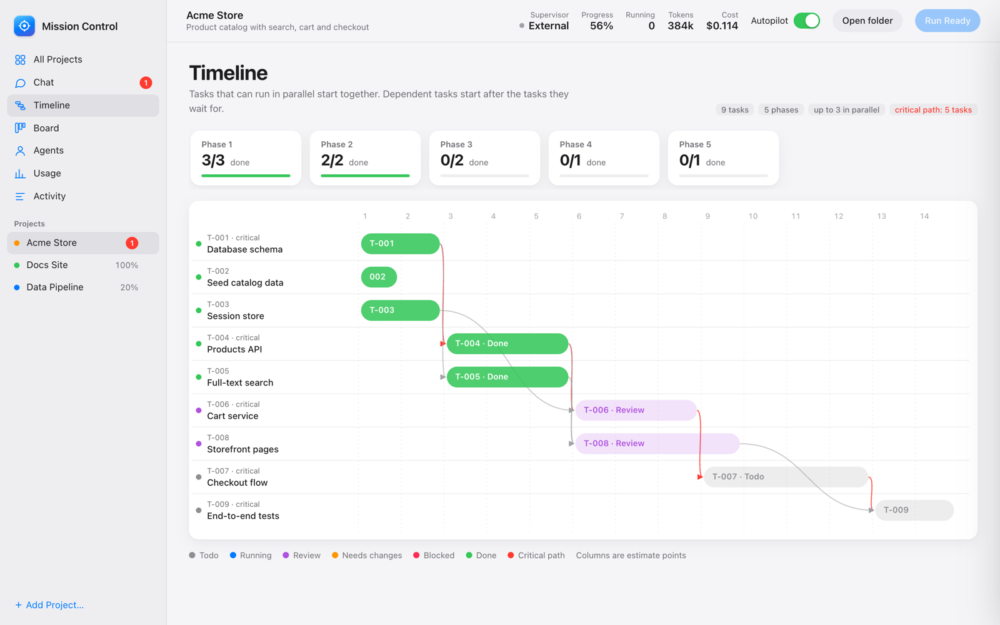
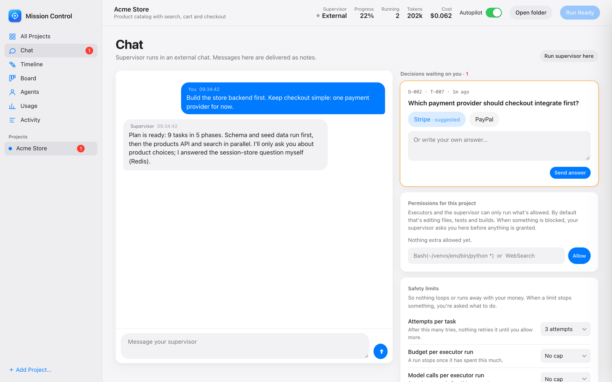
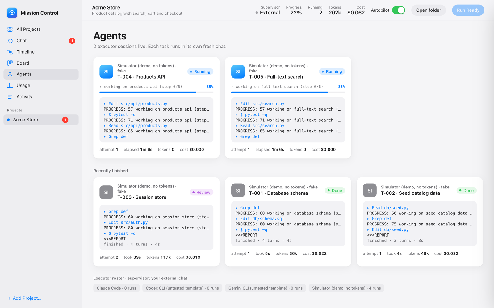
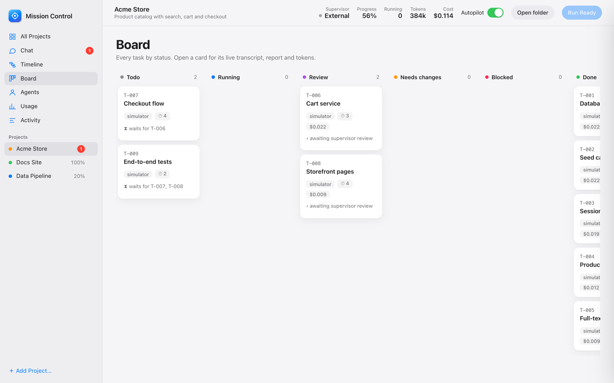
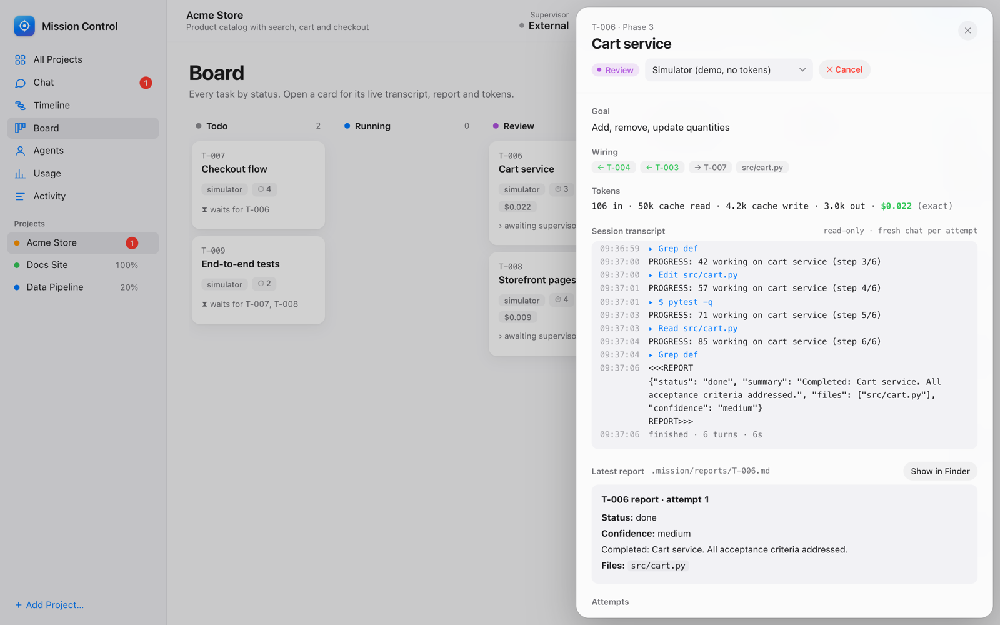
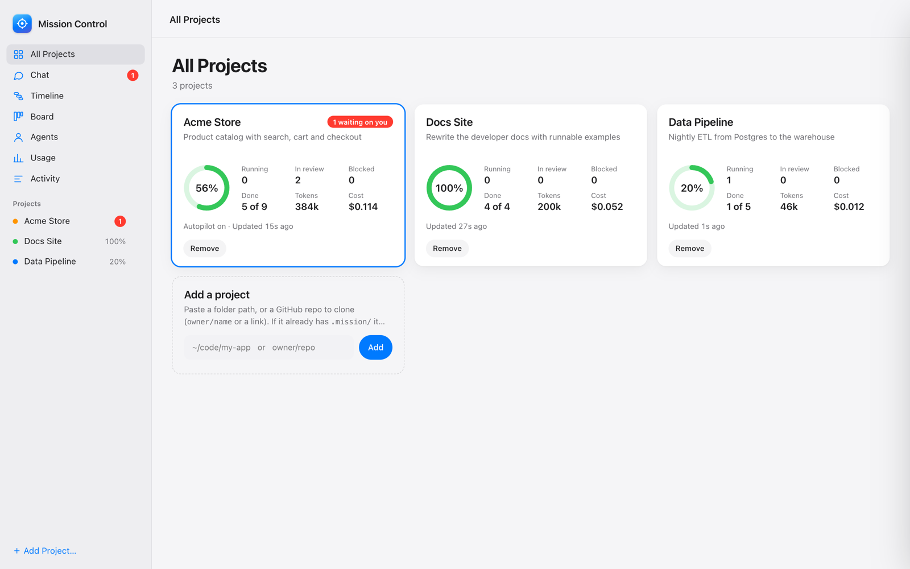
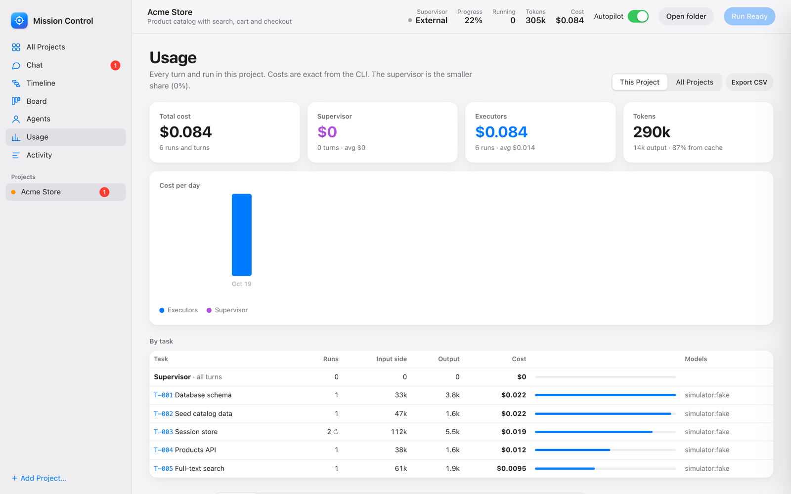
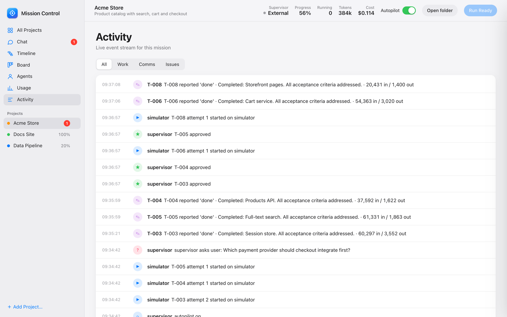
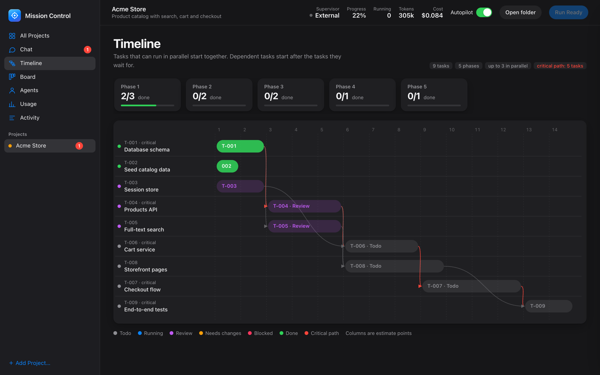

# Mission Control

**Let an expensive model plan, and cheap models do the work.** Mission Control turns your AI chat into a *supervisor* that splits a project into small tasks and hands each one to a cheaper *executor* model in its own fresh session. It then reviews their reports and answers their questions. You follow everything in a live local dashboard.



```
 you ⇄ SUPERVISOR (your chat, e.g. Opus)
          │  plan · review · answer
          ▼
     .mission/  ← plain files: tasks, reports, questions, events
          ▲
          │  one fresh session per task
   EXECUTORS (Haiku / Sonnet / Codex / Gemini …)
```

## Why
- **Spend less.** The expensive model only plans, reviews and decides. Hands-on work goes to models that cost a fraction as much, and each executor starts with a ~300–500-word brief instead of your whole chat history.
- **Run in parallel.** Independent tasks run at the same time. Dependent tasks start on their own once their prerequisites are done.
- **Stay in control.** Executors never talk to you. You get one supervisor to talk to, and a short list of decisions only you can make: permissions, pricier models, product choices.
- **No lock-in.** State is plain files in `<project>/.mission/`, so any AI that can run a shell can pick up a mission. Python 3.9+ standard library only: nothing to `pip install`.

## Features
| | |
|---|---|
| 🧭 **Supervisor / executor loop** | Plan → run → review → approve or request changes. Executors ask *blocking* questions and the supervisor answers them. Retries are capped. |
| 📊 **Live dashboard** | One local dashboard for all your projects: timeline with critical path, board, live agent transcripts, usage and costs, activity feed, chat. Light and dark mode. |
| ⚡ **Autopilot** | Tasks launch automatically as soon as their dependencies finish, up to your parallel limit. |
| ✅ **Objective checks** | Give a task a `check` (tests, build, lint). If it passes, the task auto-approves without a supervisor turn. |
| 💸 **Cost control** | Exact per-run tokens and cost, a per-run budget cap, and a model-call cap. The supervisor can pick a *cheaper* model on its own, but a pricier one needs your OK. |
| 🔐 **Sandboxed full access** | Agents run any command without asking, confined by the OS to the project folder and a list of sites. Snapshots before every run let you restore any file. |
| 🌿 **Git and teams** | Each task works in its own worktree and branch, merged into `mission/<name>` on approval. You can hand tasks to teammates as GitHub issues and PRs, and finish with one PR (with a preview first). |
| ☀️ **Today page** | Start your day with to-dos, reminders and notes, plus to-dos suggested from emails you copy into a folder (no mail access needed). |
| 🔔 **Notifications** | Get pinged on your desktop, phone (ntfy), Slack/Discord or any webhook when a decision is waiting, something fails or a mission finishes. |
| ⏳ **Watches** | Wait for long external jobs (simulations, downloads) without polling and without spending tokens. |
| 🔁 **Disposable chats** | `STATE.md` checkpoints let you drop a long supervisor chat and say "resume mission" in a fresh one. |
| 🧪 **Simulator** | A fake executor that uses no tokens, so you can try the whole flow for free. |

## Contents
[Quick start](#quick-start) · [Tour](#tour) · [Install](#install-once) · [Platforms and agents](#supported-platforms-and-agents) · [Use it in a project](#use-it-in-any-project) · [Models](#choose-your-models-expensive-supervisor-cheap-executors) · [Dashboard](#dashboard-one-for-all-projects) · [Watches](#waiting-for-long-jobs-watches) · [Today](#today-your-start-of-day-page) · [Notifications](#notifications) · [Safety limits](#safety-limits-nothing-loops-nothing-runs-away) · [Permissions](#permissions-sandboxed-full-access) · [Snapshots](#snapshots-undo-anything-an-agent-did) · [Security model](#security-model-read-before-use) · [Teams and git](#teams-git-github-and-teammates) · [Runners](#runners-adding-any-ai) · [Token model](#token-model) · [Files](#files) · [License](#license)

## Quick start
**Fastest:** download the repo and run one command. It checks Python, git and which AI CLIs (Claude, Codex, Gemini) you have, picks a sensible default, and opens the dashboard.
```bash
python3 start.py          # Windows: double-click start.bat, or: python start.py
```
Nothing else to configure. If Claude isn't installed but Codex or Gemini is, new projects use that one. The steps below are the manual route.

**1. Install** (macOS, Linux or Windows, Python 3.9+):
```bash
git clone https://github.com/karimialii/mission-control.git
cd mission-control && bash install.sh
```
On Windows, use WSL2 and the same commands (recommended), or native PowerShell with `.\install.ps1`. See [Windows](#windows).

**2. Try it for free** with the simulator (no model calls). Windows PowerShell users: see [Windows](#windows) for the equivalent commands.
```bash
mkdir -p /tmp/mc-demo && cd /tmp/mc-demo
mc() { python3 "$HOME/.claude/skills/mission-control/scripts/mc.py" "$@"; }
mc init --name Demo --goal "Try mission control" --executor simulator
echo '{"tasks":[{"key":"a","title":"Schema"},{"key":"b","title":"Auth [ask]"},{"key":"c","title":"API","deps":["a","b"]}]}' | mc plan -
mc dashboard --open   # then toggle Autopilot
```
A task with `[ask]` in its title makes the simulator ask a question. Answer it with `mc answer Q-001 "..."`, and approve finished tasks with `mc review T-001 approve`. The examples below write `mc.py`, which is the same command.

**3. Use it for real.** In Claude Code, open your project and say:
> Use mission control to build the checkout flow.

Or open the dashboard, choose **All Projects → Add a project**, paste a folder or `owner/repo`, and press **🚀 Ignite**.

## Tour
**Chat.** Your one conversation with the supervisor. Decisions waiting on you appear as one-click cards, next to project permissions and safety limits.



**Agents.** Live executor sessions: current step, progress, streaming transcript, elapsed time, tokens and cost.



**Board and task details.** Every task by status. Open a card to see its goal, wiring, tokens, full transcript per attempt and the latest report.




**All Projects.** Every mission at a glance, with what's waiting on you.



**Usage.** Exact cost and tokens per task, per day and per run, for one project or all of them. Exports to CSV.



<details>
<summary>More: Activity feed and dark mode</summary>



</details>

*Screenshots show the built-in simulator on demo projects.*

## Work packages, milestones and phases
Real projects are planned in rounds: you plan, build, look at the result, and plan again. Mission Control structures a mission like a research project:

```
Mission
 └─ Work package   a large area of work ("Software brain", "Hardware"); several can run in parallel
     └─ Milestone   one plan → build → review cycle, with a goal and "done when" criteria
         └─ Phase   automatic: tasks that can run together (dependency order)
             └─ Task   what one executor does
```

- **Each milestone ends with a review gate.** When its tasks are finished, the supervisor runs the full checks, writes an **outcome** (what was built, what didn't work, what it learned, open questions) and proposes the next milestone. You approve that plan in the dashboard, with the previous outcome shown above it, before anything in it runs.
- **One open milestone per work package**, so each area moves step by step while different areas can progress side by side.
- **Timeline and Board** show a milestone bar: click a milestone to see its tasks, goal, criteria and outcome. With a single milestone the bar stays hidden, so small missions look as before.
- Existing missions become `WP1` / `M1.1` automatically.
- Commands: `mc wp new --title … --goal …`, `mc milestone new --wp WP1 --title … --goal … --done-when …`, `mc milestone close M1.1 --outcome …`, `mc wp close WP1 --summary …`, `mc milestones`.

## Today: your start-of-day page
The dashboard opens on **Today**: your to-dos, reminders, notes, the projects waiting on you, and suggestions from your inbox.

**Inbox without giving access to your mail.** Mission Control never connects to Outlook, Teams or any mail server. You copy emails and meeting notes into Markdown files in one folder (one email per file, or several separated by a `---` line) and set that folder under **Today → Settings**. Including the `From:`, `Date:` and `Subject:` lines makes sorting much more accurate.

Every minute (or when you press **Process now**), each new email is read by a cheap model that has **no tools** and must answer in a fixed format. It picks the project the email is about, writes a one-line reason and suggests to-dos and reminders. Nothing is added until you accept it. Files that were read move to `processed/` inside the folder.

- **Sorting by project** uses each project's name and goal, plus the "also known by" names you add in Settings (clients, colleagues, codenames). Unsure matches say so. When you move an email to another project, the sender is remembered and their next emails go there without asking the model.
- **Reminders** ping your notification channels once at their time (see [Notifications](#notifications)).
- **Calendar.** Export your calendar as an `.ics` file (Apple Calendar: File → Export; Outlook: Save Calendar) and either add its path under **Today → Settings → Calendars**, or drop the file into your inbox folder (a newer export with the same name replaces the old one). Today shows the day's meetings with a "now" line, a week strip to look ahead, an **Open calendar** button for the full **Calendar** page (Day, Week, Month and List views; keys D/W/M/L, ← → and T for today; click a meeting for its details), and **Join** buttons for Teams, Zoom, Meet and Webex links. You get a ping 15 minutes before each meeting (adjustable, or off). The file is read on your computer with no model involved: time zones, recurring meetings, and moved or cancelled instances are handled.
- **Who reads the emails:** Claude Haiku by default (about $0.001 per email), Sonnet, a **local command** that keeps the text on your computer (for example `["ollama","run","qwen2.5","--format","json"]`), or a free simulator for trying it out. **Check your organisation's rules before sending work email to a cloud model.**
- Emails are treated as untrusted: the reader can't act, and instructions inside an email are ignored.
- State is in `~/.mission-control/today/`, readable only by you.

## Notifications
Long runs shouldn't wait on you. Mission Control can ping you when:
- **a decision is waiting** (a question, permission or model request for you),
- **something failed** (a runner error or a failed check),
- **every task is done** (once per completion; adding tasks re-arms it),
- **a watched external job** finished or failed.

Channels: **desktop** (macOS and Linux with `notify-send`), **ntfy** (push to your phone), **Slack/Discord** webhook, and a generic **JSON webhook**. Set them up in **Settings → Notifications**, or from the CLI:
```bash
mc notify set desktop                       # on (use --off to switch a channel off)
mc notify set ntfy my-private-topic         # then install the ntfy app and subscribe to that topic
mc notify set slack https://hooks.slack.com/services/...
mc notify mute watch                        # stop one kind (unmute to bring it back)
mc notify test                              # sends a test to every channel that is on
```
Settings are global (`~/.mission-control/notify.json`, readable only by you) and apply to every project. Notes:
- Messages include short task summaries. Only use channels you trust, and treat webhook URLs and ntfy topics as secrets (the dashboard never shows them in full).
- The supervisor can't change these settings. Set `MC_NOTIFY=0` to silence everything for one run (for example in CI).
- A channel that fails never affects a mission; errors go to `~/.mission-control/notify.log`.

## Install (once)
```bash
bash install.sh          # macOS, Linux, WSL
```
```powershell
.\install.ps1            # native Windows (PowerShell)
```
This links the folder to `~/.claude/skills/mission-control` (a symlink, or a directory junction on Windows). Nothing is copied into your projects.

## Supported platforms and agents
- **OS:** macOS and Linux (tested). Windows: WSL2 runs it as plain Linux, and native Windows is supported but **experimental** (see [Windows](#windows)).
- **Requirements:** Python 3.9+ (stdlib only), `git`, and optionally the GitHub CLI (`gh`) for issues and pull requests.

| Agent | As supervisor | As executor |
|---|---|---|
| Claude Code | Tested. `install.sh` installs it as a skill | Tested (`claude` runner) |
| Codex CLI | Works (`codex-supervisor`) | Works (`codex` runner) |
| Gemini CLI | Untested template; add an approval mode you trust | Untested template; without an approval flag, headless tool calls may stall |
| Any other agent with a shell | Point it at `AGENTS.md` / `SKILL.md` and run `python3 <path-to-this-folder>/scripts/mc.py` | Hand it `mc.py brief T-00x`; it reports with `mc.py report` |

`install.sh` / `install.ps1` only install for Claude Code. For other agents, clone this folder anywhere and tell the agent where it is (for example, reference `AGENTS.md` from your project's own `AGENTS.md`). Replace "this skill's base directory" in `SKILL.md` with that path. Check the Codex and Gemini runner flags in `runners.default.json` against your installed CLI version before relying on them.

### Windows
**Recommended: WSL2.** Inside a WSL shell it is plain Linux, so use the Linux instructions and keep your projects in the WSL filesystem. The dashboard opens at `http://127.0.0.1:7777/` from your Windows browser.

**Native Windows (experimental).** The code has Windows paths for file locking, process control, folder opening and UTF-8, but it has only been exercised on macOS so far. Please report problems. What you need:
- Python 3.9+ on `PATH` as `python` (or `py`), and `git`.
- **Git for Windows** if your tasks use `--check`: checks are written in bash syntax and run through Git Bash.
- A **native `.exe`** build of the agent CLI (for example Claude Code's native installer). Runners that resolve to a `.cmd`/`.bat` wrapper (typical for npm-installed CLIs) are refused, because `cmd.exe` would re-interpret the prompt. Use WSL for those.

```powershell
git clone https://github.com/karimialii/mission-control.git
cd mission-control; .\install.ps1
function mc { python "$HOME\.claude\skills\mission-control\scripts\mc.py" @args }
mkdir $HOME\mc-demo; cd $HOME\mc-demo
mc init --name Demo --goal "Try mission control" --executor simulator
mc dashboard --open
```
Stopping a task ends its whole process tree with `taskkill /T /F`. Processes are listed with PowerShell, which makes `mc watch --gone` a little slower than on macOS and Linux.

## Use it in any project
There are two ways to start, and both end up in the same dashboard.

**A · From the dashboard (recommended).** Start the dashboard, go to **All Projects → Add a project**, and paste a folder path **or a GitHub repo** (`owner/name` or a link). A repo is cloned for you (with the GitHub CLI when available, so private repos you can access work) into `~/Documents/GitHub` or the folder you choose.
- If the folder already has `.mission/`, it joins the fleet.
- If it doesn't, you get **🚀 Ignite Mission Control**. Pick your models (below) and ignite.

The supervisor then runs inside the dashboard, and the **Chat** tab is your one conversation with it:
1. **Briefing.** It takes a cheap look at the project and asks what you want: the goal, must-haves, constraints, and what "done" means.
2. **Plan.** Once you agree on the goal, it writes the plan. The mission waits in **awaiting approval**, and nothing runs. Review the plan in **Timeline**, or ask for changes in Chat.
3. **Approve & launch.** Executors start, and Autopilot runs dependent tasks as their prerequisites finish. The supervisor wakes automatically when executors report or ask questions. It reviews, answers, and keeps you posted in Chat. It pauses after 40 turns without a message from you (you can change this).

**B · From a Claude Code chat.** In the project, say "Use mission control to build X". Your chat becomes the supervisor and the dashboard just shows progress. "Resume mission" picks it up later.

`.mission/.gitignore` keeps transcripts out of git. Commit the rest if you want a task history.

## Choose your models (expensive supervisor, cheap executors)
Pick a **provider** (the CLI) and a **model** for each role. You do this on the Ignite screen, in **Chat → Models**, or with the CLI:
```bash
mc.py models --supervisor claude-supervisor:opus --executor claude:haiku
mc.py models --supervisor claude-supervisor:fable --executor gemini:<gemini-model-id>
```
- **Prices are shown in the dropdown** (list price per million input / output tokens), with a one-line hint on what each model suits and how many times the cheapest it costs. A warning appears if your executors are set to a pricier model than your supervisor.
- **Effort** (low, medium, high, extra high, max) sets how hard the model thinks before answering. It's a second cost lever: higher is more thorough on hard problems but slower and costlier. Set it per role under each model (Claude providers), or with `mc.py models --supervisor-effort medium --executor-effort low`. "Default" uses the CLI's own default.
- Supervisor providers: `claude-supervisor`, `codex-supervisor`, `gemini-supervisor`.
- Executor providers: `claude`, `codex`, `gemini`, `simulator`.
- The model is any id that CLI accepts (`haiku`, `sonnet`, `opus`, `fable`, a Gemini or OpenAI model id…). Leave it empty for the CLI's default.
- **The supervisor can go cheaper on its own, but not pricier.** It may give a simple task a cheaper model than the one you chose. For a more expensive model (or another provider) it has to ask you with `mc.py request-model`: you see the reason and the cost difference in Chat, and the model changes only when you press Allow. Prices used for this comparison are list prices in `runners.default.json` (`model_price`); an unknown model counts as needing approval. To switch the rule off for a mission, set `"allow_model_overrides": true` in `.mission/mission.json`.
- Changing the executor provider moves tasks that haven't run yet onto it. A single task can override this with `"model"` in the plan, or with `mc.py set T-003 executor=claude model=sonnet`.
- Claude supervisors keep one resumed session, reset automatically when the context gets large. Supervisors on CLIs without session resume start every turn fresh from `STATE.md` plus the recent chat.

## Dashboard (one for all projects)
```bash
python3 ~/.claude/skills/mission-control/scripts/mc.py dashboard --open
```
It runs at http://127.0.0.1:7777 and is local only.

| View | What it shows |
|---|---|
| All Projects | Every project: progress ring, phase, supervisor status, cost, "needs you" badge. **+ Add a project**, and 🚀 Ignite for folders not yet under Mission Control |
| Timeline | Dependency timeline. Parallel tasks start together and dependent tasks start after their prerequisites. Shows the critical path, live progress, and phase groups |
| Board | Tasks by status, with ▶ Run / ■ Stop |
| Agents | Live executor sessions: current step, progress, streaming transcript, elapsed time, tokens |
| Usage | Cost and tokens for the project or for **all projects**: totals, cost per day, **per task**, and a ledger of **every supervisor turn and executor run** (click one to see each model call inside it: what it did, tokens, cost). Export everything as CSV. Costs are exact from the CLI; per-call output and cost are the exact run totals split by token weight |
| Activity | Every event, filterable |
| Chat | Your conversation with the supervisor, the model picker, decisions waiting on you (one-click options), the plan-approval banner, and the executor ⇄ supervisor thread |

Click any task to see its goal, criteria, dependencies, full session transcript per attempt, report, feedback, questions, attempt history, and an executor switcher.

The **Autopilot** toggle launches tasks automatically as soon as their dependencies are done. **Run Ready** does that once.

## Waiting for long jobs (watches)
Some work happens outside Mission Control: a simulation that runs for hours, a download. The supervisor must never sit and poll, so it registers a **watch** and ends its turn:

```bash
mc.py watch add "Base-case run" --file runs/full150/DONE \
   --fail-contains runs/full150/run.log Traceback \
   --fail-if-gone "S2_runs/full150_c41" --every 60 --hours 6 --task T-001 \
   --note "run the postprocess and review T-001"
```

The dashboard checks it every N seconds **without using any tokens**, and wakes the supervisor when it's done, failed, or timed out. Watches are listed under **Chat → Waiting for** (cancel with ×), and with `mc.py watch list` / `watch cancel W-001`.

- **Conditions:** `--file PATH` appears, `--contains PATH TEXT`, `--gone PATTERN` (no running process's command line contains it). Failure: `--fail-contains`, `--fail-file`, `--fail-if-gone`.
- **Deliberately not shell commands.** The conditions are a small set of read-only checks inside the project folder, so a watch can't be used to run commands the supervisor isn't allowed to run.
- At most 10 active watches per mission. Without the dashboard running, an external supervisor's `mc wait` checks them too.

## Safety limits (nothing loops, nothing runs away)
Set in **Settings → Safety limits**, or `mc.py limits`:

| Limit | Default | What happens at the limit |
|---|---|---|
| **Attempts per task** | 3 | The task stops being retried. A card asks you: *Allow 2 more attempts* or *Stop this task*. Neither autopilot nor the supervisor can restart it; only you can (the Run button asks you to confirm). |
| **Budget per executor run** | no cap | The run stops once it has spent this much (it can overshoot by one model call) and the task goes to review with the reason. |
| **Model calls per executor run** | no cap | The run is stopped after this many steps (a long exploring loop). Its cost is estimated from the calls seen. |
| **Supervisor turns without you** | 40 | The dashboard supervisor pauses until you write. |

**Your supervisor can be blocked too.** It runs headless with a fixed allow-list, so a command outside it is denied outright: there's no prompt anywhere to approve. Mission Control turns the denial into an **Allow / Don't allow** card under *Decisions waiting on you*, with the narrowest rule that works (`git fetch *`, not `git *`) and a plain-words note of what it does. Commands that publish (`git push`, `gh pr create`) are allowed only as the *exact* command asked for, force-pushes are flagged, and the supervisor wakes with your answer.

**Blocked by a permission?** The moment a run ends blocked or failed because commands were denied, a permission card appears in Chat (no supervisor tokens used) and the task is held. Press **Allow** and the task retries by itself; press **Don't allow** and the supervisor is told to find another way. Nothing retries into the same wall.

## Where the files are
Everything Mission Control writes about a project is in the hidden folder `<project>/.mission/`: `reports/T-001.md` (each executor's report), `feedback/`, `runs/` (full session transcripts), `usage.jsonl` (every turn and run), `chat.jsonl`, `STATE.md`. Finder hides folders that start with a dot: use **Open folder** in the toolbar, or **Show in Finder** in a task's report, or press ⇧⌘. in Finder. What the executors actually produce (code, data, documents) is written into the project itself (in git mode, into the task's worktree until it is merged).

## Permissions: sandboxed full access
By default the supervisor and executors (Claude) have **full access inside the project**: they run any command without stopping to ask. The operating system keeps them in bounds using Claude Code's built-in sandbox:

- **Writes** go only to the folder the agent works in (the project, or the task's own worktree in git mode) and a private temp folder. Everything else on your computer is read-only to them.
- **Your keys are hidden:** `~/.ssh`, `~/.aws`, `~/.gnupg`, GitHub CLI logins, `~/.netrc`, Docker and Kubernetes configs, and your private Mission Control data (Today page, notification settings).
- **Internet** is limited to a list of sites, by default package registries and GitHub (`pypi.org`, `files.pythonhosted.org`, `registry.npmjs.org`, `github.com`, `*.githubusercontent.com`). Edit it per project in **Settings → What agents can do**. When an agent needs another site, the supervisor asks you (a `Domain(example.com)` request with **Allow** / **Don't allow**).
- `/tmp` is writable and Unix sockets under `/tmp` are allowed, for test servers that need short socket paths.
- There is no "run it outside the sandbox" escape hatch. Only Mission Control's own `mc` command runs outside it, so the supervisor can launch executors. When it runs `mc` inside the sandbox (in a pipeline, say), runs and notifications are handed to the dashboard, which carries them out.

The sandbox works on macOS out of the box and on Linux/WSL2 with `bubblewrap` and `socat` installed. Where it isn't available, Mission Control falls back to **only allowed commands**, the older mode where each kind of command is allowed one by one (you can also choose that mode in Settings). Codex uses its own `workspace-write` sandbox; Gemini needs an approval mode you choose.

## Snapshots: undo anything an agent did
Because agents can change anything in the project, Mission Control keeps restorable copies of the folder:

- **When:** before every agent run (executor attempts and supervisor turns), every 30 minutes while agents are working, and whenever you press **Take a snapshot now**. If nothing changed since the last one, nothing is saved.
- **How long:** 7 days, then they're deleted automatically.
- **Where:** a private store in `.mission/snapshots.git`, separate from your project's own git, so it works in any folder and never touches your history. Each file is stored once, however many snapshots contain it.
- **What's skipped:** files over 50 MB, cloud files that are online-only (OneDrive/iCloud placeholders, so nothing gets downloaded), anything your `.gitignore` excludes, and folders like `node_modules`, `.venv`, `build`.
- **Restoring:** in **Settings → Snapshots**, open a snapshot to see which files differ from now, then restore one file or all of them. Files created after the snapshot are kept. The current state is snapshotted first, so a restore can itself be undone.

## Security model (read before use)
The sandbox confines shell commands, but it is not a full virtual machine. Run missions only on code and briefs you trust, ideally in a container or VM for untrusted repos.

- **Executors run code.** In sandboxed mode any command runs, confined as described above. In allow-list mode, a written file can still be run through allowed commands such as `python3 -m …`.
- **Reads aren't confined to the project.** Shell commands can't read the hidden key folders, but Claude's own `Read` tool follows permission rules instead of the sandbox and can read other files your user can.
- **`check` commands run in a shell** (`shell=True`) with your user's rights. Whoever writes the plan decides what runs.
- **The dashboard is local only.** It binds to `127.0.0.1` and rejects other `Host` headers (which blocks DNS rebinding). Every state-changing request needs a per-run random token. Read-only endpoints serve only projects you registered. Any process running as your user on this machine can still reach it.
- **What stays on your machine:** `.mission/` (transcripts, reports, costs) and `~/.mission-control/` (project registry, runner overrides). Nothing is sent anywhere except through the AI CLIs you configure and, in git mode, `git push` / `gh` to your own remote.

## Using the supervisor chat in Claude Code
The dashboard supervisor is a headless Claude session, saved on disk but not listed in the desktop app's session list. In **Chat**, **Open in Claude Code** copies `cd "<project>" && claude --resume <session>`. Paste it in a terminal to continue the same conversation interactively. Executor sessions aren't saved (their transcripts are in the dashboard).

## Removing a project
Hover a project in the sidebar and press ×, or use **Remove** on its card in All Projects (or `mc.py projects --remove <path>`). This only takes it off the dashboard: your files and the project's `.mission/` data stay exactly where they are, and adding the folder again brings everything back. Running tasks keep going but nothing supervises them while the project is off the dashboard.

## Teams: git, GitHub and teammates
Missions are safe to run in a shared repository:

- **Your checkout is never touched.** When work starts in a git repo, Mission Control creates `mission/<name>` from the latest `origin/<your branch>`, in a separate worktree (`.mission/worktrees/_mission`). `.mission/` is excluded locally through `.git/info/exclude`, so the shared `.gitignore` is unchanged.
- **Each AI task works in its own worktree and branch.** Approval merges the task into the mission branch. Conflicts go back to the executor, and unresolved conflict markers are never committed.
- **You can assign tasks to people.** In a task's sheet, choose **Assign to a person…**, or use `"assignee": "sara"` in the plan, or `mc.py assign T-004 --to sara`. Pressing **Hand Off**:
  - pushes a task branch and opens a GitHub issue with the full brief, assigned to them;
  - they work normally and open a PR into the mission branch;
  - their issue comments go to the supervisor, and the answers are posted back;
  - their PR becomes a review for the supervisor, which approves (merge and close) or requests changes (a comment on their PR);
  - AI tasks that depend on them wait, then start automatically.
- **No GitHub?** Use **Copy Brief** to share the brief and **Mark Done** when they're finished.
- **One pull request at the end.** When every task is done, **Create Pull Request** (or `mc.py pr`) merges the latest base, pushes the mission branch, and opens a PR describing the tasks, who did them, and the decisions made. Your team reviews it like any other PR, and CI is the final check.
- **A PR can only target a branch that exists on the remote.** If the mission was built on a branch that only exists on your machine, `mc.py pr` stops **before pushing anything** and explains. **Create Pull Request** then offers to open it against the repo's default branch (or run `mc.py pr --target main`), with **only the mission's own changes**: your unpublished commits are not dragged in. If the changes depend on that unpublished work, you're told, and the usual fix is to push that branch first.
- **Preview before publishing:** `mc.py pr --target main --dry-run` shows exactly which files and lines would go into the pull request, what is left out, and whether it applies cleanly. It pushes nothing and changes nothing.
- **When `main` has moved ahead** of the branch the mission was built on (common for long missions), run `mc.py sync-base --target main --check "<tests>"`. It adds a task that merges the latest `main` into the mission and resolves any conflicts, keeping both sides' intent and re-running your tests. A task whose changes can't be committed (conflict markers left in a file) goes back to the executor, never to "done". Then open the pull request: it is `main` plus the mission's own work.
- Agent tool folders (`.claude-flow`, `.swarm`, `.hive-mind`, …) are never committed, and tasks that finish at the same moment merge one at a time.
- **What's needed:** `git`, plus the GitHub CLI (`gh auth login`) for issues and PRs. Nothing is ever force-pushed, and only `mission/*` branches are pushed.
- **Turn it off for a project** with `mc.py git off`, and work then happens directly in the folder.

## Runners (adding any AI)
Runner templates live in `runners.default.json`. To override or add one, create `~/.mission-control/runners.json`. Set an entry to `null` to hide a runner.

```json
{
  "my-local": {"label": "Local LLM", "role": "executor", "parser": "text", "model": "qwen3",
               "model_args": ["--model", "{model}"],
               "cmd": ["my-agent", "{model_args}", "--prompt-file", "{prompt_file}"],
               "price": {"in": 0, "out": 0}},
  "gemini": null
}
```

- **`role`:** `executor` or `supervisor`. Supervisor runners also take `"resume": true/false`, plus `{system}` if the CLI has a system-prompt flag. Without it, the playbook is prepended to the prompt.
- **`{model_args}`** expands to `model_args` only when a model is set.
- **Placeholders:** `{prompt}`, `{prompt_file}`, `{model}`, `{model_args}`, `{system}`, `{task}`, `{root}`, `{mc}`, `{python}`.
- **Parsers:** `claude` (stream-json, exact tokens and cost), `codex` (`exec --json`), `gemini` (`--output-format json`), and `text` (anything; the report is parsed from the output).
- **`price`** (USD per million tokens) is used to estimate cost when a CLI reports tokens but not cost.
- **Permissions.** Claude executors run headless with `acceptEdits` and a Bash allowlist (not a sandbox, see *Security model*): tests, builds, `python3 -m …`, `npm run …`, `git diff`/`status`, `ls`, `cat`. The supervisor also gets `mc`. Widen `--allowedTools` per runner if your tasks need more. Defaulting to skip-permissions isn't recommended.
- **Token overhead.** Claude runners pass `--strict-mcp-config --disable-slash-commands --no-session-persistence`. That keeps your MCP servers and skills out of each executor's context, which cut per-request context by about 35% (36.5k → 23.6k tokens) in testing.
- A task's `check` command is pre-approved for its executor, matched by the command prefix before any quote. A check like `python3 -c '...'` therefore allows `python3 -c *`, so prefer checks like `pytest tests/x -q`.
- `pip install`, `python3 -m pip` and `npm install` are blocked for Claude runners. Add dependencies yourself, or remove them from `--disallowedTools`.
- The Gemini supervisor template has no auto-approval flag. Add the approval mode you trust for your Gemini CLI.
- The `codex` and `gemini` entries (executor and supervisor) are templates that haven't been tested. Check their flags against your installed CLI version.

## Token model
- Executors start fresh for every task and every retry. Their context is only the brief, about 300–500 words plus your codebase reads.
- The supervisor never reads transcripts, only ≤150-word reports. `mc.py wait` blocks without using model tokens.
- Tasks with a `check` command auto-approve when the check passes, so there's no supervisor review turn. In dashboard mode, the supervisor wakes only for things that need judgment: reviews, questions, errors, your messages, and the end of the mission. Routine events ride along in its next turn.
- `.mission/STATE.md` (`mc.py checkpoint`) lets you throw away a long supervisor chat and resume in a fresh one.
- Token counts are exact for runners that report usage (Claude, Codex, Gemini) and self-reported for manual executors. The supervisor's own chat isn't counted.

## Files
```
.mission/
  mission.json        name, goal, autopilot, max_parallel
  tasks/T-001.json    brief, deps, status, progress, tokens, attempts
  reports/T-001.md    latest executor report (+ check result)
  feedback/T-001.md   supervisor feedback rounds
  questions/Q-001.json  executor→supervisor and supervisor→user questions
  notes.jsonl         your messages to the supervisor
  decisions.md        decision log
  events.jsonl        everything that happened (dashboard feed)
  runs/T-001/         prompts, raw streams and transcripts per attempt
  STATE.md            compact resume file
```
Global, in `~/.mission-control/`: `projects.json` (the project list), `notify.json` (notification settings, private), `today/` (to-dos, reminders, inbox suggestions; private), `notify.log` (delivery errors).

## License
MIT. See `LICENSE`.
